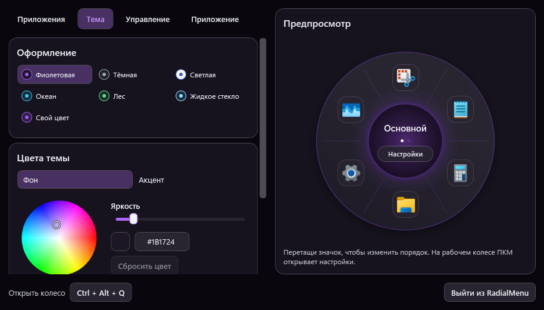

  
  <h1>RadialMenu</h1>
  
<strong>Your favorite apps, one mouse gesture away</strong>

  
Open the wheel right where your cursor is and pick a slice. Set up separate wheels for work, games, and everyday shortcuts, with each app in a direction you can remember.

  
<a href="README.md">Русский</a> · <strong>English</strong>

  

## See RadialMenu in action

- **A wheel at your cursor.** Pick an app by direction. If it already has an open window, RadialMenu brings it to the foreground.
- **Layouts for different tasks.** Search installed apps by name, add folders and websites, and group shortcuts in submenus. Drag icons around the preview to rearrange them.
- **Selection in one move.** Hold your shortcut key or a side mouse button, point at a slice, and release. You can pause the wheel in games you choose.
- **Make it yours.** Adjust the background and accent of each theme, wheel size, and transparency. See changes immediately in the full-size preview.

  

## Install

1. Open the [latest release](https://github.com/applimenu/RadialMenu/releases/latest) and download `RadialMenu-Setup-win-x64.exe` under **Assets**.
2. Run the installer, then open RadialMenu from the Start menu. The installer includes the .NET runtime.
3. Press **Ctrl + Alt + Q** to open the wheel. Select **Settings («Настройки»)** in the center.

## Build from source

Open `RadialMenu1.slnx` in Visual Studio with .NET 11 and WPF support. See the [release guide](installer/RELEASE.md) for installer build steps (in Russian).
