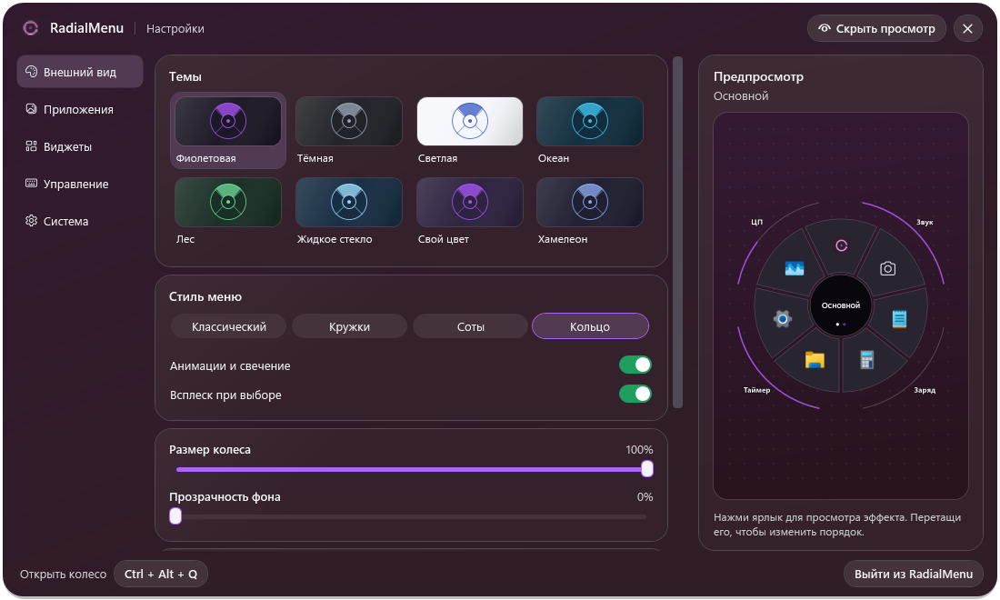
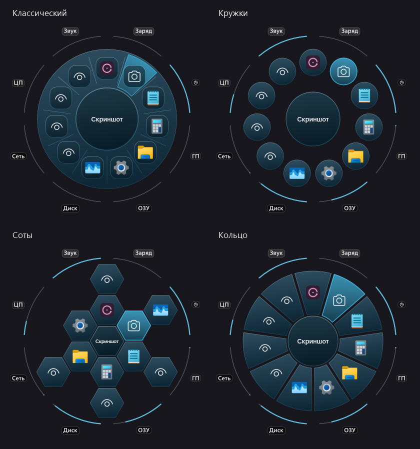

# RadialMenu

**A radial launcher for Windows.** Press **Ctrl + Alt + Q** to open the wheel at your pointer. Select a shortcut to open an app, folder or website. The outer ring shows live system metrics.

**[Download for Windows x64](https://github.com/applimenu/RadialMenu/releases/latest/download/RadialMenu-Setup-win-x64.exe)** · [1.8.0 release notes](https://github.com/applimenu/RadialMenu/releases/tag/v1.8.0) · [Русский](README.md)

## Build your wheel

Arrange work apps, project folders and websites by direction. Create a separate wheel for games. Drag a shortcut in the live preview to put it where you expect to find it.

Choose **Classic**, **Circles**, **Honeycomb** or **Ring**. Adjust the size, transparency and glow, or use the **Chameleon** theme for automatic colors.

## From a status arc to a desktop widget

- **Check system load.** Choose which arcs to show around the wheel, including CPU, GPU, memory, network and battery.
- **Keep a metric on screen.** Click its arc to pin a widget. Drag it to a free grid slot. Right-click to resize it or switch to a compact desktop card.
- **Keep playing.** Enable compact widgets under **Controls → Games**. While a game is active, the cards show their readings and let clicks pass through to the game.
- **Record the screen.** Start a silent MP4 recording from the tray menu or the **System** settings. Open the recordings folder from either place.

## First launch

1. Download and run the Windows x64 installer. It includes the .NET runtime.
2. Open RadialMenu from Start and press **Ctrl + Alt + Q**.
3. Select the settings shortcut at the top of the wheel to add your apps. Under **Controls**, you can assign a side mouse button and enable selection on release.

If you use version 1.2.2 or earlier, upgrade once using the installer. Your settings carry over.

## Build

Open `RadialMenu1.slnx` in Visual Studio with .NET 11 and WPF support, or run `dotnet build RadialMenu1.slnx -c Release` on Windows. [Installer build guide](installer/RELEASE.md)
