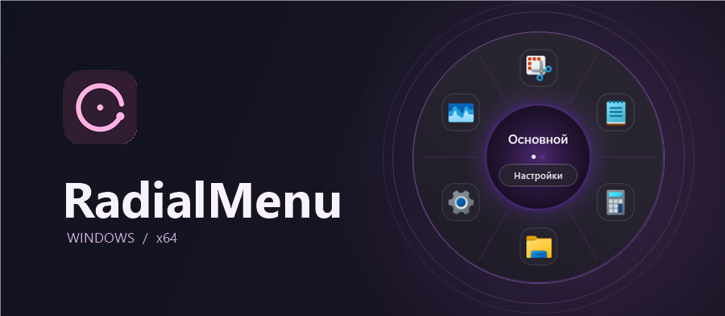
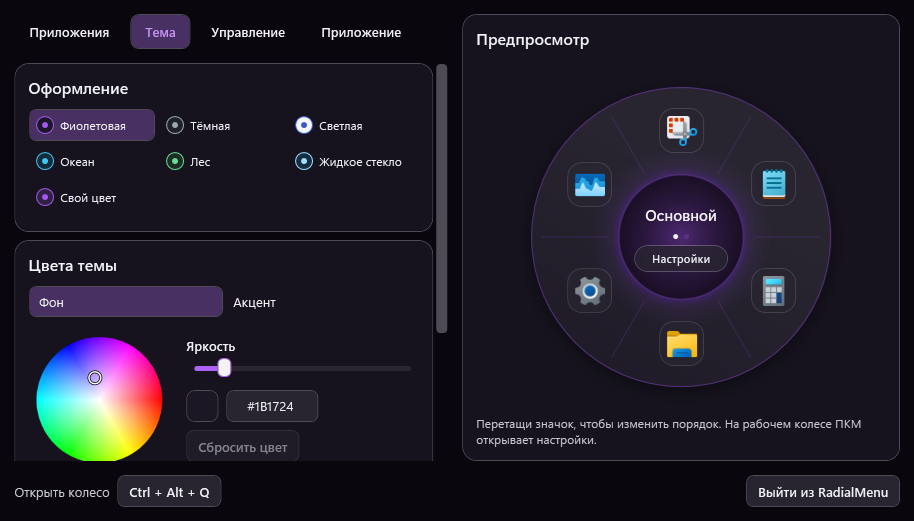

  
  <h1>RadialMenu</h1>
  
<strong>Любимые приложения в одном движении мыши</strong>

  
Вызовите колесо там, где сейчас курсор, и выберите нужный сектор. Соберите отдельные колёса для работы, игр и повседневных задач и разложите значки по знакомым направлениям.

  
<strong>Русский</strong> · <a href="README.en.md">English</a>

  

## Как выглядит RadialMenu

- **Колесо у курсора.** Выбирайте приложение по направлению. Если его окно уже открыто, RadialMenu поднимет его на передний план.
- **Раскладки под разные задачи.** Ищите установленные приложения по имени, добавляйте папки и сайты, собирайте разделы в подменю. Порядок значков меняется перетаскиванием прямо на предпросмотре.
- **Выбор одним движением.** Удерживайте горячую клавишу или боковую кнопку мыши, наведите курсор на сектор и отпустите. В выбранных играх колесо можно ставить на паузу.
- **Оформление под себя.** Настройте фон и акцент каждой темы, размер колеса и прозрачность. Изменения сразу видны в полноразмерном предпросмотре.

  

## Установка

1. Откройте [последний релиз](https://github.com/ilhomwwe-creator/RadialMenu/releases/latest) и скачайте `RadialMenu-Setup-win-x64.exe` из раздела **Assets**.
2. Запустите установщик, затем откройте RadialMenu из меню «Пуск». Среда .NET уже входит в установщик.
3. Нажмите **Ctrl + Alt + Q**, чтобы вызвать колесо. Кнопка **«Настройки»** находится в его центре.

## Сборка из исходников

Откройте `RadialMenu1.slnx` в Visual Studio с поддержкой .NET 11 и WPF. Сборка установщика описана в [руководстве по релизам](installer/RELEASE.md).
